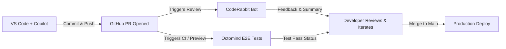

# DevFlow: AI-Assisted Frontend Development & GitHub Workflows

A React 19 + Vite web application architected with an AI-assisted development, continuous integration, and review pipeline.

---

## 🚀 Workflow Overview



1. **Development**: GitHub Copilot generates modular components and tests adhering to [`.github/copilot-instructions.md`](./.github/copilot-instructions.md).
2. **Pull Request**: [CodeRabbit](https://coderabbit.ai) analyzes the diff, comments inline on problematic lines, and provides high-level PR summaries using [`.coderabbit.yaml`](./.coderabbit.yaml).
3. **Continuous Integration**: [Octomind](https://app.octomind.dev) runs autonomous, self-healing Playwright E2E user flows via [`.github/workflows/e2e-octomind.yml`](./.github/workflows/e2e-octomind.yml).
4. **Merge**: PR merges to `main` only when both CodeRabbit reviews and Octomind tests pass.

---

## 🛠 Project Structure

```text
├── .github/
│   ├── copilot-instructions.md      # Copilot coding conventions & architecture rules
│   └── workflows/
│       ├── e2e-octomind.yml         # Octomind AI E2E GitHub Actions workflow
│       └── ci.yml                   # Oxlint & build validation
├── .coderabbit.yaml                 # CodeRabbit AI PR review guidelines
├── src/
│   ├── components/
│   │   ├── TaskCard.jsx             # Accessible task card generated via Copilot prompt
│   │   ├── CopilotCanvas.jsx        # Live Copilot component gallery & prompt viewer
│   │   ├── OctomindDashboard.jsx    # Real-time E2E test runs & failure auto-recovery
│   │   ├── CodeRabbitReview.jsx     # PR review walkthrough & AI suggestions
│   │   └── WorkflowDrawer.jsx       # CI/CD configuration inspector drawer
│   ├── App.jsx                      # Main dashboard layout
│   └── index.css                    # Design system tokens and styling
```

---

## 📋 AI Tools Configuration

### 1. GitHub Copilot Instructions
Configured in [`.github/copilot-instructions.md`](./.github/copilot-instructions.md):
- **Stack**: React (functional components, React Hooks), Vite, modern CSS.
- **Conventions**:
  - Modular, reusable components with clear prop types / interfaces.
  - State kept local unless shared across pages or contexts.
  - Descriptive handler names (e.g., `handleToggleComplete`, `handleDeleteConfirm`).
  - Strict accessibility attributes (`aria-*`, keyboard `Enter`/`Space` handlers, semantic roles).

#### Example Inline Prompt:
```javascript
// src/components/TaskCard.jsx
// Prompt: Create an accessible TaskCard component with a checkbox, title, priority badge, and delete button with confirmation.
```

### 2. Autonomous E2E Testing with Octomind
Configured in [`.github/workflows/e2e-octomind.yml`](./.github/workflows/e2e-octomind.yml):
1. Create a project at [app.octomind.dev](https://app.octomind.dev).
2. In your GitHub repository, configure secrets under **Settings > Secrets and variables > Actions**:
   - `OCTOMIND_API_KEY`: API key generated from the Octomind dashboard.
   - `OCTOMIND_TEST_TARGET_ID`: Target project ID.
3. Every pull request triggers headless browser flows against your staging or preview deployment.

### 3. Automated PR Reviews with CodeRabbit
Configured in [`.coderabbit.yaml`](./.coderabbit.yaml):
- Profile: `chill` (focuses on bugs, security, and accessibility without noisy nitpicks).
- Automated reviews on all PRs targeting `main`.
- Enforces proper error states, cleanup handlers in `useEffect`, accessible labels, and no committed secrets.

---

## 💻 Local Development

### Prerequisites
- Node.js (v18+)
- npm

### Setup
```bash
# Clone the repository
git clone https://github.com/<your-username>/<your-repo-name>.git
cd <your-repo-name>

# Install dependencies
npm install

# Start Vite development server
npm run dev
```

Visit [http://localhost:5174/](http://localhost:5174/) to interact with the DevFlow dashboard, Copilot canvas, Octomind test suite, and CodeRabbit review center.
